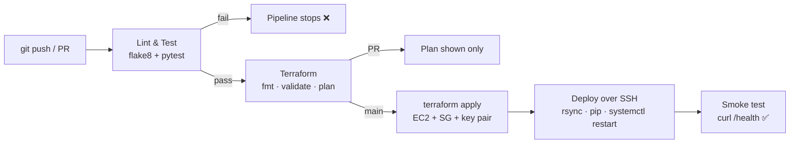

# Flask API → EC2 with Terraform + GitHub Actions

A demo CI/CD pipeline. Every push to `main` **tests** a Flask REST API, **provisions** an EC2 instance with Terraform, **deploys** the code over SSH and **smoke-tests** the live URL. Pull requests run only the tests and a `terraform plan`, so broken code never reaches the server.



## Project layout

```
.
├── app/
│   ├── __init__.py
│   └── app.py                 # Flask API (/, /health, /api/items CRUD)
├── tests/
│   └── test_app.py            # pytest unit tests
├── terraform/
│   ├── versions.tf            # provider + S3 remote state backend
│   ├── variables.tf
│   ├── main.tf                # AMI lookup, key pair, security group, EC2
│   ├── outputs.tf             # public IP + URL
│   ├── user_data.sh           # first boot: python, nginx, gunicorn systemd unit
│   └── terraform.tfvars.example
├── .github/workflows/
│   ├── ci-cd.yml              # test → terraform → deploy → smoke test
│   └── destroy.yml            # manual teardown
├── requirements.txt
├── requirements-dev.txt
└── pytest.ini
```

On the server: **nginx (port 80) → gunicorn (127.0.0.1:8000) → Flask**, managed by systemd.

## API

| Method | Path | Description |
|---|---|---|
| GET | `/` | Message + deployed version (git SHA) |
| GET | `/health` | Health check used by the smoke test |
| GET | `/api/items` | List items |
| GET | `/api/items/<id>` | Get one item |
| POST | `/api/items` | Create `{"name": "..."}` |
| PUT | `/api/items/<id>` | Update `{"name": "..."}` |
| DELETE | `/api/items/<id>` | Delete |

## 1. Run locally

```bash
python -m venv .venv && source .venv/bin/activate   # Windows: .venv\Scripts\activate
pip install -r requirements-dev.txt
pytest -v                 # run tests
flake8 .                  # lint
python -m app.app         # http://localhost:5000
```

## 2. One-time AWS setup

**a) IAM user for GitHub Actions** with permissions for EC2 and the state bucket (for a demo, `AmazonEC2FullAccess` + `AmazonS3FullAccess`). Create an access key.

**b) S3 bucket for Terraform state** (bucket names are globally unique):

```bash
BUCKET=flask-demo-tfstate-$RANDOM
aws s3api create-bucket --bucket $BUCKET --region ap-south-1 \
  --create-bucket-configuration LocationConstraint=ap-south-1
aws s3api put-bucket-versioning --bucket $BUCKET --versioning-configuration Status=Enabled
echo $BUCKET
```

**c) SSH key pair for deployments:**

```bash
ssh-keygen -t ed25519 -f deploy_key -N "" -C "github-actions-deploy"
# deploy_key      -> private key (secret)
# deploy_key.pub  -> public key  (Terraform registers it on EC2)
```

## 3. GitHub repository secrets

*Settings → Secrets and variables → Actions → New repository secret*

| Secret | Value |
|---|---|
| `AWS_ACCESS_KEY_ID` | IAM access key |
| `AWS_SECRET_ACCESS_KEY` | IAM secret key |
| `TF_STATE_BUCKET` | bucket name from step 2b |
| `EC2_SSH_PUBLIC_KEY` | contents of `deploy_key.pub` |
| `EC2_SSH_PRIVATE_KEY` | contents of `deploy_key` (including the BEGIN/END lines) |

Optionally create an Environment named `production` (*Settings → Environments*) and add yourself as a required reviewer to get a manual approval gate before deploy.

## 4. Push with git and watch the pipeline

```bash
git init
git add .
git commit -m "Flask API with Terraform + GitHub Actions pipeline"
git branch -M main
git remote add origin https://github.com/<your-user>/flask-ec2-pipeline.git
git push -u origin main
```

Open the **Actions** tab: `Lint & Test → Terraform → Deploy to EC2`. The deploy job links to the app URL; open `http://<public-dns>/` and you'll see the commit SHA that's running.

### Demo script: show that tests gate the deployment

```bash
# 1. Feature branch + pull request
git checkout -b feature/add-version-endpoint
#   ...edit app/app.py and tests/test_app.py...
git commit -am "Add endpoint"
git push -u origin feature/add-version-endpoint
#   Open a PR → only tests + terraform plan run. Nothing is deployed.

# 2. Break a test on purpose and push → the PR goes red, deploy can't happen.
# 3. Fix it, merge the PR → pipeline runs on main and deploys.
#    Refresh the URL: the version field shows the new commit SHA.
```

Tip: add a branch protection rule on `main` requiring the **Lint & Test** check, so a failing PR can't even be merged.

## 5. Tear down (avoid charges)

*Actions → Destroy infrastructure → Run workflow* → type `destroy`.

Then delete the state bucket manually if you're done with it.

## Notes for production use

- **Use OIDC instead of access keys:** `aws-actions/configure-aws-credentials` supports `role-to-assume` with GitHub's OIDC provider, so no long-lived keys are stored in GitHub.
- **Restrict SSH:** port 22 is open to `0.0.0.0/0` because GitHub-hosted runners have changing IPs. Alternatives: AWS SSM Session Manager / Run Command, a self-hosted runner in the VPC, or opening the SG to the runner's IP only during the deploy step.
- **HTTPS:** put an ALB with an ACM certificate in front, or use certbot on nginx.
- **Persistence:** the item store is in-memory and resets on restart; use RDS/DynamoDB for real data.
- **Immutable deploys:** for larger setups, bake an AMI (Packer) or ship a Docker image to ECR and run it on ECS instead of SSH-ing code onto a server.
